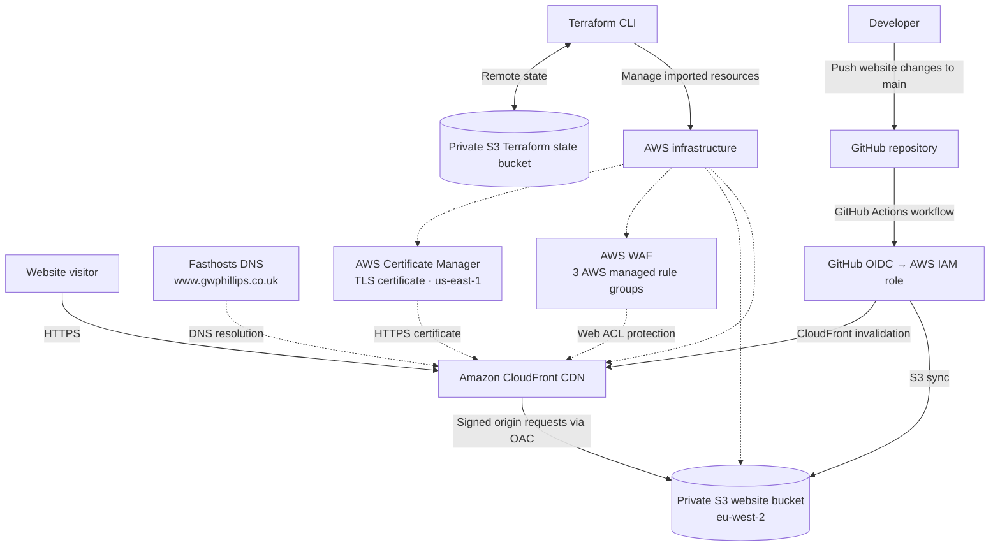

# AWS Cloud Portfolio | Terraform, CloudFront & GitHub Actions

[**Live website**](https://www.gwphillips.co.uk) · [**GitHub repository**](https://github.com/gregp1985/aws-cloud-portfolio) · [**LinkedIn**](https://www.linkedin.com/in/gregwphillips/)

A live, AWS-hosted cloud engineering portfolio demonstrating secure static website delivery, Infrastructure as Code (IaC), identity federation, and automated deployment. The website is served through Amazon CloudFront from a **private Amazon S3 bucket**, protected by AWS WAF, and deployed through **GitHub Actions using short-lived AWS credentials via OIDC**.

The infrastructure was initially configured in AWS, then **imported into Terraform state** and reconciled until `terraform plan` reported **no changes** across 11 managed resources.

## Architecture



> **Deployment and infrastructure management are separate:** GitHub Actions publishes website files; Terraform manages the AWS resource configuration. The deployment workflow does **not** automatically run `terraform apply`.

## Technology stack

| Area | Technology | Purpose |
| --- | --- | --- |
| Hosting | Amazon S3 (`eu-west-2`) | Private storage for static website assets |
| Content delivery | Amazon CloudFront | CDN, caching, custom domain, HTTPS redirect |
| Origin access | CloudFront Origin Access Control (OAC) | Signed requests to the private S3 origin |
| TLS | AWS Certificate Manager (`us-east-1`) | Amazon-issued, DNS-validated wildcard certificate |
| Web protection | AWS WAF | AWS managed IP reputation, core rules and known-bad-input rules |
| Identity | AWS IAM + GitHub OIDC | Branch-restricted, short-lived deployment credentials |
| Infrastructure as Code | Terraform + AWS provider | Declarative management of existing AWS resources |
| Terraform backend | Separate S3 bucket (`eu-west-2`) | Remote state, encryption, versioning and state locking |
| CI/CD | GitHub Actions | Website file sync and CloudFront cache invalidation |
| DNS | Fasthosts | DNS records and ACM validation CNAME |

## Security design

- **Private origin:** S3 Block Public Access is fully enabled. CloudFront accesses website objects through OAC and a bucket policy restricted to the specific distribution ARN.
- **HTTPS:** CloudFront redirects HTTP to HTTPS and uses an ACM-issued wildcard certificate. The certificate is DNS-validated and eligible for managed renewal.
- **WAF:** Three AWS-managed rule groups are enabled: Amazon IP Reputation List, Core Rule Set, and Known Bad Inputs.
- **No long-lived AWS deployment keys:** GitHub Actions assumes an IAM role through OIDC. The role trust policy is restricted to this repository's `main` branch.
- **Least-privilege deployment role:** Permissions cover listing the website bucket, reading/writing/deleting its objects, and creating invalidations for the specific CloudFront distribution.
- **Versioned, encrypted storage:** S3 bucket versioning and SSE-S3 (AES256) encryption are enabled; the website bucket also blocks SSE-C encryption.
- **State isolation:** Terraform remote state is stored in a separate private S3 bucket and excluded from Git.

## CI/CD workflow

Changes under `website/` on the `main` branch trigger the GitHub Actions deployment workflow:

1. Check out the repository.
2. Exchange the GitHub OIDC token for temporary AWS credentials through the restricted IAM role.
3. Synchronise `website/` to the private S3 website bucket using `aws s3 sync --delete`.
4. Create a CloudFront invalidation (`/*`) to refresh cached assets.

Workflow definition: [`.github/workflows/deploy.yml`](.github/workflows/deploy.yml).

> Changes only to Terraform files do not deploy infrastructure. Infrastructure updates require deliberate review and execution outside this website deployment workflow.

## Terraform: adopting live infrastructure

Rather than recreating the production environment, the existing resources were imported into Terraform state and the HCL configuration was adjusted to match the live AWS configuration.

**11 managed resources:**

| Terraform resource | Purpose |
| --- | --- |
| `aws_s3_bucket.portfolio` | Website origin bucket |
| `aws_s3_bucket_public_access_block.portfolio` | Public access restrictions |
| `aws_s3_bucket_versioning.portfolio` | Object versioning |
| `aws_s3_bucket_server_side_encryption_configuration.portfolio` | Encryption controls |
| `aws_s3_bucket_policy.portfolio` | CloudFront-only origin access |
| `aws_cloudfront_origin_access_control.portfolio` | Signed S3 origin requests |
| `aws_cloudfront_distribution.portfolio` | CDN, HTTPS and cache behaviour |
| `aws_iam_role.github_actions_deploy` | GitHub OIDC trust |
| `aws_iam_role_policy.github_actions_deploy` | Scoped deployment permissions |
| `aws_acm_certificate.portfolio` | TLS certificate |
| `aws_wafv2_web_acl.portfolio` | Web application firewall |

The imported configuration was checked with:

```bash
cd terraform
terraform init
terraform fmt -check
terraform validate
terraform plan
```

**Verified result:** `No changes. Your infrastructure matches the configuration.`

Terraform resources protecting critical infrastructure use `prevent_destroy` where configured. The separate Terraform state bucket is bootstrapped and managed outside this Terraform root configuration to avoid a dependency on its own state.

### Terraform safety notes

- `terraform plan` is the review step before any infrastructure modification.
- Do not run `terraform apply` against a new account or environment without first reviewing names, providers, certificates, dependencies and policies; this configuration reflects **existing imported infrastructure**.
- Existing ACM DNS-validation records are maintained at Fasthosts rather than created by Terraform.
- `.terraform/`, local state files, `.tfvars`, and credential files must not be committed. `.terraform.lock.hcl` should be committed.

## Repository structure

```text
aws-cloud-portfolio/
├── .github/
│   └── workflows/
│       └── deploy.yml       # Website deployment via OIDC
├── website/
│   ├── index.html
│   └── assets/              # Static site assets
├── terraform/
│   ├── backend.tf           # S3 remote state backend
│   ├── main.tf              # Imported AWS resources
│   ├── outputs.tf
│   ├── providers.tf
│   ├── variables.tf
│   ├── versions.tf
│   └── .terraform.lock.hcl  # Provider dependency lock file
├── .gitignore
└── README.md
```

## Engineering decisions and lessons

- **OAC instead of a public S3 website endpoint:** Keeps the origin private while allowing CloudFront to retrieve content securely.
- **OIDC instead of static IAM access keys:** Removes the need to store long-lived AWS credentials in GitHub secrets.
- **Resource import instead of recreation:** Demonstrates a safe adoption path for existing infrastructure, with zero-change plans used to detect drift or accidental modifications.
- **Certificate region matters:** CloudFront uses an ACM certificate in `us-east-1`, while the S3 website and Terraform state buckets are in `eu-west-2`.
- **Separate deployment and infrastructure workflows:** A content update can be published automatically without granting the deployment role broad Terraform administration permissions.

## Scope and future improvements

This repository focuses on the static website delivery platform and its supporting AWS infrastructure. Potential follow-up improvements include infrastructure validation in pull requests, CloudFront monitoring and alerts, and further Terraform modularisation. These are **future enhancements**, not claimed as implemented here.

## Author

**Greg Phillips** — AWS Certified Solutions Architect – Associate  
[Portfolio](https://www.gwphillips.co.uk) · [GitHub](https://github.com/gregp1985) · [LinkedIn](https://www.linkedin.com/in/gregwphillips/)
